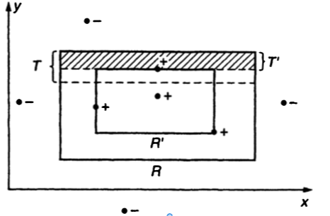

The purpose of this post is to learn about the Probably Approximately
Correct Learning model introduced by Valiant in "A Theory of the Learnable."
This model is relevant because it is the first formal framework to study the process
of learning from a computational viewpoint. Computability theory and
complexity theory became possible once we had a rigorous model of the
phenomenon of mechanical calculations (Turing Machines) that could be
used to explain the phenomenon and was valuable to study for its own
sake. In this line, the phenomenon of learning is also very relevant and
needs a model that is valuable for its own sake and also explains the
process of learning and its limits. Valiant defines that a
program to perform a task has been acquired by *learning* if it has been
acquired by any means different to explicit programming.

||
|:--:| 
| *Leslie Valiant* |

A learning game
===============

In this section we are going to follow Section 1.1 of Kearns and Vazirani's book. Let us
consider the following 1-player game of learning an axis-aligned
rectangle, that is, given an unknown axis-aligned rectangle
($$\mathcal{R}$$, called the **target**) in the Euclidean plane the player
receives from time to time a point of the plane $$p$$, sampled from a fixed
and unknown distribution $$\mathcal{D}$$, and a label that indicates if
$$p\in \mathcal{R}$$. The goal of the player is to select, using as few
examples and as little computation as possible, a **hypothesis** rectangle
$$\mathcal{R'}$$ that approximates well the target rectangle
$$\mathcal{R}$$. We use as the measure of error the probability of a point
sampled from $$\mathcal{D}$$ falling on
$$\mathcal{R}\triangle \mathcal{R'}$$.

A concrete situation that motivates this game is that of learning the
concept of \"men of medium build\". We will say that a man is of medium
build if his height and weight both lie in some prescribed range, for
example if his height is between 170 and 180 cm and his weight between
70 and 90 kg. The build of each man can be represented as a point in the
plane with height and weight as coordinates and the concept of being of
medium build is represented as a rectangle aligned with the axes. So to
learn this concept, for a training period the learner is given examples
of men and their dimensions and is told if they are of medium build or
not. The learner needs to construct a hypothesis of the concept of men
of medium build. After that the learner goes outside and walks around
his city and sees every man with the same probability, but even in that
case, the points that represent their builds may not follow a uniform
distribution, but a fixed distribution $$\mathcal{D}$$. Evaluating the
success of the learner is done by evaluating his success on classifying
men in future encounters, given that they follow the same distribution
$$\mathcal{D}$$ from where we sampled the examples during the training
phase.

For this game there is a simple strategy for the learner: the strategy
consists of requesting a sufficiently large sample of size $$m$$ and choosing
as $$\mathcal{R'}$$ the smallest axis-aligned rectangle which contains
all of the positive examples and none of the negative examples. We say
that this rectangle is the \"tightest-fit rectangle\".  

##### __Theorem 1.__  

For any target rectangle $$\mathcal{R}$$ and for any distribution $$\mathcal{D}$$, and for all
values $$\epsilon > 0, 0 < \delta\leq \frac{1}{2}$$ there exists a value $$m$$ of the
sample size for which with probability at least $$1-\delta$$ the tightest-fit
rectangle has error at most $$\epsilon$$.

##### **Proof**

 
Remember that the error of $$\mathcal{R'}$$ is defined as
$$\mathbb{P}_{x \sim \mathcal{D}}(x\in \mathcal{R}\triangle \mathcal{R'} )$$
and by definition of tightest-fit $$\mathcal{R'}\subseteq \mathcal{R}$$ so
the error is equal to
$$\mathbb{P}_{x \sim \mathcal{D}}(x\in \mathcal{R}\setminus \mathcal{R'} )$$.
We can express the difference $$\mathcal{R}\setminus \mathcal{R'}$$ as the
union of 4 rectangular strips. For example, the topmost of these strips,
which is denoted T' in Figure 1, is the region above the upper boundary
of $$\mathcal{R'}$$ extended to the left and right, but below the upper
boundary of $$\mathcal{R}$$. There is some overlap between these 4
rectangular strips at the corners. We will show that the weight of each
strip, that is the probability with respect to $$\mathcal{D}$$ of falling
in each strip, is at most $$\frac{\epsilon}{4}$$ (it is clear that this bound
is not tight). Without loss of generality we will analyze the top strip
$$T'$$.

||
|:--:| 
| *Figure 1* |

Define T as the rectangular strip along the inside top of $$\mathcal{R}$$
which encloses exactly weight $$\frac{\epsilon}{4}$$ under $$\mathcal{D}$$
(we take the upper side of $$\mathcal{R}$$ and drag a rectangle going
down; under assumptions of continuity of measures we can always find a
rectangle with the exact area that we want). We note that the weight of
$$T'$$ can exceed $$\frac{\epsilon}{4}$$ only if $$T\subseteq T'$$ (which does not
happen in the figure). Furthermore, $$T\subseteq T'$$ iff no point of $$T$$
appears in the sample (otherwise the point would lie in $$\mathcal{R'}$$,
by definition of tightest fit).

By the definition of $$T$$ the probability that a single draw from
$$\mathcal{D}$$ misses the region $$T$$ is exactly $$1-\frac{\epsilon}{4}$$.
As the samples are independent and identically distributed, the
probability that $$m$$ draws from $$\mathcal{D}$$ all miss the region is
exactly $$(1-\frac{\epsilon}{4})^{m}$$. This analysis also applies to the
other 3 strips, so by the union bound the probability that some strip has
weight greater than $$\frac{\epsilon}{4}$$ is at most
$$4(1-\frac{\epsilon}{4})^{m}$$. To prove our claim it only remains to
show that we can choose an $$m$$ that satisfies
$$4(1-\frac{\epsilon}{4})^{m}\leq \delta$$. Now we remember the famous
inequality that $$(1-x)\leq e^{-x}$$ and we deduce that
$$4(1-\frac{\epsilon}{4})^{m}\leq 4 e^{\frac{-\epsilon m}{4}}$$, and using
logarithms we conclude that
$$m\geq \frac{4}{\epsilon} ln(\frac{4}{\delta})$$ satisfies what we are
looking for.  

The previous result shows that our strategy only needs a sample of size
$$\frac{4}{\epsilon} ln(\frac{4}{\delta})$$ to find a hypothesis rectangle
that with probability $$1-\delta$$ will have an error of classification
with probability at most $$\epsilon$$. Also, the only assumption about
the sample is that the examples are i.i.d.; we do not need
a condition on the distribution itself. On the other hand, if we want
to increase accuracy by reducing $$\epsilon$$ or to increase confidence by
reducing $$\delta$$, the number of examples that we need grows slowly,
linearly on $$\frac{1}{\epsilon}$$ and logarithmically on $$\frac{1}{\delta}$$.
Finally, the amount of computation that we need to build $$\mathcal{R'}$$
given the examples is low.

The general PAC model
=====================

Now we will introduce the general PAC model, and for this we need some
definitions.

We will call a set **X** the **Instance Space**; we think of it as the
encodings of objects in the learner's world.

A **concept** over X is a subset $$c\subset X$$ of the instance space.
Equivalently we can define a concept as a Boolean function
$$c: X\rightarrow\{0,1\}$$ such that $$c(x)=1$$ means that $$x$$ is a positive
example, and $$c(x)=0$$ that it is a negative example.

A **concept class $$\mathcal{C}$$** over X is a collection of concepts
over X.

In our model, a learning algorithm will have access to positive and
negative examples of an unknown **Target Concept** $$c \in \mathcal{C}$$
where $$\mathcal{C}$$ is a $$\textbf{known}$$ concept class. The examples
follow a fixed distribution $$\mathcal{D}$$. We will define the error of
the algorithm as follows.

Given a concept $$h\subseteq X$$ and a target concept $$c$$, and a distribution
$$\mathcal{D}$$, the $$\textbf{error}$$ between $$h$$ and $$c$$ is defined as
$$error(h) = \mathbb{P}_{x\sim \mathcal{D}}(c(x)\neq h(x))$$.

We will denote as $$EX(c,\mathcal{D})$$ an oracle that runs in unit time
and on each call returns a labeled example $$(x, c(x))$$ where $$x$$ is
drawn i.i.d. from $$\mathcal{D}$$.

Now we can finally define the PAC model. Note that this definition is
the original definition of the model but has been modified in the
literature for issues of representation of concepts (see 1.22 of
Kearns and Vazirani for details).

##### **The PAC model** 

Let $$\mathcal{C}$$ be a concept class over X. We say that
$$\mathcal{C}$$ is PAC learnable if there exists an algorithm $$L$$ with the
following property: for every concept $$c\in \mathcal{C}$$, for every
distribution $$\mathcal{D}$$ on X and for all $$0 < \epsilon, \delta
< \frac{1}{2}$$ if $$L$$ is given access to $$EX(c,\mathcal{D})$$ and
inputs $$\epsilon$$ and $$\delta$$, then with probability at least $$1-\delta$$, $$L$$
outputs a hypothesis concept $$h\in \mathcal{C}$$ with
$$error(h)\leq \epsilon$$. This probability is taken over the random
examples drawn by calls to $$EX(c,\mathcal{D})$$, and any internal randomization of
L.

If L runs in time polynomial in $$\frac{1}{\epsilon}$$ and
$$\frac{1}{\delta}$$ we say that $$\mathcal{C}$$ is efficiently PAC
learnable.

Given that definition, Theorem 1 says that the concept class of axis-aligned rectangles over the
Euclidean plane is efficiently PAC learnable.

Conjunctions of Boolean literals are efficiently PAC learnable
===========================================================

Let us consider the instance space $$X_{n}=\{0,1\}^{n}$$, and each element of
the space is interpreted as an assignment to the $$n$$ Boolean variables
$$x_{1}\cdots x_{n}$$. Let us consider the concept class $$\mathcal{C}_{n}$$ to
be the class of all conjunctions of literals over $$x_{1}\cdots x_{n}$$.
We want to prove the following theorem.

##### __Theorem 2.__  

The concept class of conjunctions of Boolean literals is efficiently PAC
learnable.

#####  __Proof__  

We propose the following algorithm: start with the hypothesis
$$h = x_{1}\land \neg x_{1}  \land \cdots \land x_{n} \land \neg x_{n}$$
(note that initially $$h$$ is unsatisfiable). The algorithm will ignore
every negative example returned by $$EX(c,\mathcal{D})$$. In case of a
positive example $$(a,1)$$ the algorithm will update $$h$$ as follows. For
each $$i$$, if $$a_{i}=0$$, the algorithm will delete $$x_{i}$$ from $$h$$, and
if $$a_{i}=1$$, will delete $$\neg x_{i}$$ from $$h$$. That is, the algorithm
will delete every literal that contradicts the positive data.

We need to prove that it runs in time polynomial in $$\frac{1}{\epsilon}$$
and $$\frac{1}{\delta}$$.

First we note that the set of literals that appear in $$h$$ always
contains the set of literals of the target $$c$$, because we start in $$h$$
with all literals and remove them from $$h$$ only when they are set to $$0$$ in a
positive example, so $$h$$ can only fail on positive examples of $$c$$.
Consider a literal $$z$$ that occurs in $$h$$ but not in $$c$$; then $$z$$
causes $$h$$ to err only in the positive examples of $$c$$ in which $$z=0$$.
Note that these examples would have made the algorithm delete $$z$$
from $$h$$. Consider the probability of these examples, that is
$$p(z) = \mathbb{P}_{a\sim \mathcal{D}}(c(a)=1 \land z\text{ is 0 in } a )$$.
Since every error of $$h$$ is caused by at least one literal $$z$$ of $$h$$,
we have that $$error(h)\leq \sum_{z\in h} p(z)$$. We will say that a
literal is bad if $$p(z)\geq \frac{\epsilon}{2n}$$. Observe that as $$h$$
has at most $$2n$$ literals, if $$h$$ contains no bad literals then
$$error(h)\leq \sum_{z\in h} p(z)\leq 2n\frac{\epsilon}{2n}=\epsilon$$.

Now we are going to upper bound the probability that $$h$$ contains a
bad literal. The probability of deleting a literal is $$p(z)$$, and for a
fixed bad literal that is at least $$\frac{\epsilon}{2n}$$, so the
probability of not deleting a fixed bad literal in a call to the oracle
is $$1-\frac{\epsilon}{2n}$$, and after $$m$$ calls is
$$(1-\frac{\epsilon}{2n})^{m}$$. This is for a fixed bad literal, and
there are at most $$2n$$ possible literals, so the probability that there
is some bad literal in $$h$$ after $$m$$ calls is bounded above by
$$2n(1-\frac{\epsilon}{2n})^{m}$$, so we now need to find the value of $$m$$
that satisfies $$2n(1-\frac{\epsilon}{2n})^{m}\leq \delta$$. We use the
famous inequality that $$(1-x)\leq e^{-x}$$ and find that it suffices to pick
$$m$$ such that $$2ne^{\frac{-m\epsilon}{2n}}\leq \delta$$, and we conclude
that we need $$m\geq (\frac{2n}{\epsilon})(ln(2n)+ln(\frac{1}{\delta}))$$.

The bound above says that with a number of examples greater than
$$(\frac{2n}{\epsilon})(ln(2n)+ln(\frac{1}{\delta}))$$ with probability
$$1-\delta$$ the error of h will be less than $$\epsilon$$. The algorithm
takes linear time to process each example, so the running time is
bounded by $$mn$$, and that is polynomial in $$\frac{1}{\epsilon}$$ and
$$\frac{1}{\delta}$$. That concludes the proof.

References
===========================================================

Leslie G. Valiant: A Theory of the Learnable. Commun. ACM 27(11):
1134-1142 (1984)  

Michael J. Kearns, Umesh V. Vazirani: An Introduction
to Computational Learning Theory. MIT Press 1994, ISBN
978-0-262-11193-5, pp. I-XII, 1-207
